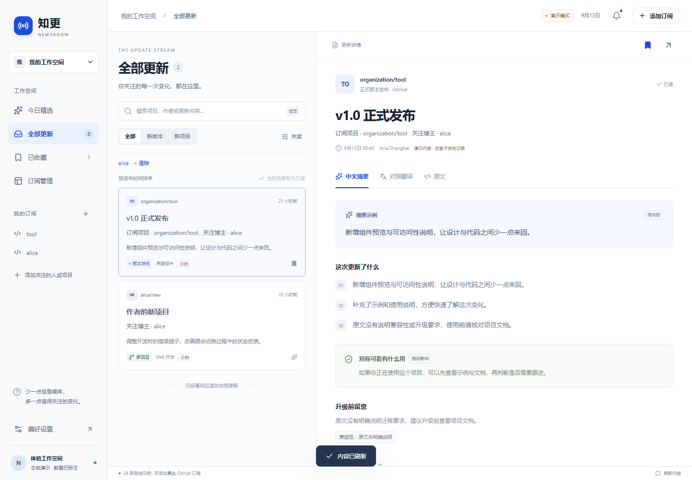
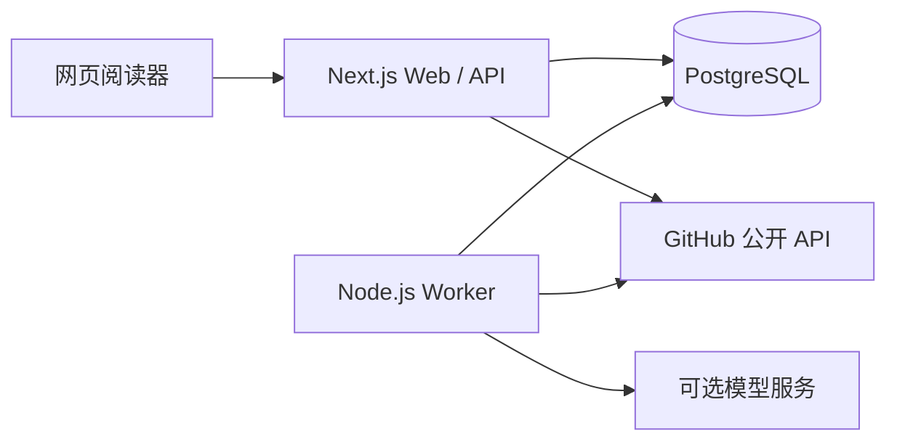

# 知更 / NEWSROOM

在一个网页里查看你关注的 GitHub 项目与开发者更新，阅读中文摘要、对照译文和原文，减少逐个打开仓库检查的时间。当前先把 GitHub 主流程做扎实，并记录 X / RSS 的跨平台扩展路线。

**当前为可运行的本地 MVP，GitHub 已接入，X / RSS 尚未接入。** 仅读取 GitHub 公开数据；网页内的订阅、已读和收藏只保存在本应用，不会替你 Star 或 Follow。没有邮件功能。



> 截图使用演示内容，展示双来源更新和阅读布局，不代表真实项目的发布记录。

## 已实现

| 功能 | 当前行为 |
| --- | --- |
| 项目订阅 | 跟踪正式 Release 和已收录版本说明的修改 |
| 博主订阅 | 跟踪其新建公开非 fork 仓库，以及本人发布的正式 Release，包含组织项目 |
| Star 导入 | 读取当前账号公开 Star，每 5 分钟发现新 Star 并加入本地订阅；取消 Star 不自动删除订阅 |
| 关注导入 | 分页读取公开 following，跨页勾选开发者，识别已订阅对象并支持部分失败重试 |
| 项目搜索 | 在「添加订阅 → 搜索项目」搜索 GitHub 公开仓库，支持排序、分页和本地订阅 |
| Trending | 独立于个人 Star 的热门发现，支持常用编程语言榜单和按需中文简介 |
| 站内阅读 | 多来源去重、搜索与筛选、已读、收藏、上下对照翻译、作者发现项目后直接订阅、桌面和手机布局 |
| AI 辅助 | 中文摘要、原文依据、按需翻译、缓存和用量预算；超长全文翻译会明确提示，模型可关闭 |
| 授权与同步 | GitHub OAuth、账号允许名单、访问令牌自动续期、后台轮询和失败提示 |
| 站内简报 | 整理近期未读更新，网页内阅读，不发送邮件或推送 |
| Skill 目录 | 浏览本机已安装 Skill 与 GitHub Star 项目中的 Skill；查看原始简介、项目/源文件链接、AI 教程式摘要和连续中英文对照 |

## 快速体验

准备 **Node.js 24+、pnpm 11、PostgreSQL 17**。推荐用 Docker Desktop 运行数据库，Web 和 Worker 在本机运行。

```powershell
git clone https://github.com/hjunhui0924-gif/news_updata.git
cd news_updata
pnpm install --frozen-lockfile
# 先启动 Docker Desktop
pnpm demo
```

打开 [http://127.0.0.1:3000](http://127.0.0.1:3000)。首次启动自动创建 `.env.local`、生成本地随机密钥、启动数据库、执行迁移并写入 24 条明确标识的演示内容，再启动 Web 和 Worker。**演示不需要 GitHub 登录或模型密钥，真实 AI 默认关闭。**

Ctrl+C 停止此次启动的应用进程，保留数据库。已有 `.env.local` 不会被覆盖；如果其中是 `APP_MODE=live`，请使用下方真实模式流程，不要用演示启动器。

已有 PostgreSQL 时，复制 `.env.example` 为 `.env.local`，设置自己的 `DATABASE_URL`、保持 `APP_MODE=demo`，执行 `pnpm demo --no-docker`。Docker Compose 只运行数据库，并非整套应用的容器镜像。

## 使用自己的 GitHub 账号

1. 复制 `.env.example` 为 `.env.local`，设 `APP_MODE=live`，填写数据库连接与随机 `BETTER_AUTH_SECRET`。
2. 在 GitHub 创建自己的 OAuth App，设置 Homepage URL 为 `http://127.0.0.1:3000`，回调为 `http://127.0.0.1:3000/api/auth/callback/github`。
3. 填写 `GITHUB_CLIENT_ID`、`GITHUB_CLIENT_SECRET` 和 `ALLOWED_GITHUB_USER_IDS`。允许名单使用 GitHub 的**稳定数字 ID**，不是用户名。
4. 启动数据库、迁移、Web 和 Worker：

```powershell
docker compose up -d --wait db # 使用现有 PostgreSQL 可跳过
pnpm db:migrate
pnpm dev
# 另开一个终端
pnpm worker:dev
```

通过网页跳转到 GitHub 官方页面登录。应用不接收 GitHub 密码；令牌服务端加密保存，按需自动续期。网页会话到期与 GitHub 授权失效是两回事。`GITHUB_READ_TOKEN` 是可选的服务端覆盖配置，普通个人使用可以留空。

仓库不包含作者的 `.env`、真实账号令牌、模型密钥或数据库，克隆后需要自己的配置。详见 [运行指南](docs/05-operations-and-quality.md)、[授权说明](docs/12-github-auth-renewal.md) 和 [安全边界](SECURITY.md)。

## AI 配置

默认可以阅读原文和体验演示译文。开启真实 AI 时，需要在 `.env.local` 设置兼容 Chat Completions 的模型地址、API Key、模型名和实际输入/输出单价，再设 `LLM_ENABLED=true`，重启 Web 与 Worker。

当前开发环境已联调 `qwen3.8-flash`；这不是仓库默认启用的付费服务。其他兼容模型需要验证结构化输出支持。摘要自动生成、全文翻译按需触发；原文会上送你配置的模型服务。预算为应用估算，不能替代供应商账户硬额度。见 [模型配置与费用](docs/05-operations-and-quality.md#模型配置)。

## 技术架构



Next.js 16 / React 19 / TypeScript 5.9、Tailwind 4、Radix Dialog、PostgreSQL 17、Drizzle + pg、pg-boss、Better Auth、Octokit、Vitest 和 Playwright。精确版本以 `package.json` 与 `pnpm-lock.yaml` 为准；不需要 Redis 或向量数据库。

## 目录结构

源码与脚本按文件列出；同类测试和配置用通配符合并，文档用途见下方「文档导航」。

```text
news_updata/
├─ src/
│  ├─ app/                                  # 页面入口与 HTTP 接口
│  │  ├─ layout.tsx                         # 根布局、页面元信息与全局样式入口
│  │  ├─ globals.css                        # 全局主题、组件样式与响应式布局
│  │  ├─ icon.svg                           # 应用图标
│  │  ├─ [[...path]]/page.tsx                # 路由分发、登录校验与首屏数据加载
│  │  └─ api/
│  │     ├─ auth/[...all]/route.ts          # 登录、会话与 GitHub OAuth 回调
│  │     ├─ bootstrap/route.ts              # 获取阅读器数据与任务、授权状态
│  │     ├─ health/live/route.ts            # Web 进程存活检查
│  │     ├─ settings/route.ts               # 读取、保存时区与紧凑布局偏好
│  │     ├─ github/
│  │     │  ├─ connection/route.ts          # 检查 GitHub 连接并更新授权状态
│  │     │  ├─ repositories/search/route.ts # 搜索公开仓库
│  │     │  ├─ following/preview/route.ts   # 分页预览关注列表与订阅状态
│  │     │  ├─ following/import/route.ts    # 将选中开发者导入本地订阅
│  │     │  ├─ starred/preview/route.ts     # 预览公开 Star 与订阅状态
│  │     │  ├─ starred/import/route.ts      # 将选中 Star 项目导入本地订阅
│  │     │  └─ starred/auto/route.ts        # 开关自动跟踪、触发 Star 同步
│  │     ├─ subscriptions/
│  │     │  ├─ route.ts                     # 查询、添加项目或博主订阅
│  │     │  ├─ [id]/route.ts                # 修改订阅偏好、删除订阅
│  │     │  └─ [id]/sync/route.ts           # 将手动同步请求加入队列
│  │     ├─ items/[id]/
│  │     │  ├─ state/route.ts               # 更新已读、收藏与静音状态
│  │     │  ├─ summary/retry/route.ts       # 重新提交摘要任务
│  │     │  └─ translation/route.ts         # 提交全文翻译任务
│  │     ├─ trending/
│  │     │  ├─ route.ts                     # 获取语言榜单与已有中文简介
│  │     │  └─ translation/route.ts         # 按需翻译榜单项目简介
│  │     ├─ skills/
│  │     │  ├─ local/route.ts               # 获取本机 Skill 目录
│  │     │  ├─ starred/route.ts             # 分页获取 Star 项目中的 Skill
│  │     │  ├─ detail/route.ts              # 获取 Skill 正文与 AI 状态
│  │     │  └─ ai/route.ts                  # 提交 Skill 摘要或翻译任务
│  │     └─ notifications/preview/route.ts  # 生成并保存站内简报预览
│  ├─ components/                          # 页面交互与可复用界面
│  │  ├─ reader-app.tsx                     # 阅读器主界面、视图切换与数据刷新
│  │  ├─ sidebar.tsx                        # 导航、订阅入口与未读计数
│  │  ├─ feed-list.tsx                      # 更新列表、选中状态与阅读标记
│  │  ├─ item-detail.tsx                    # 更新详情、摘要、原文与阅读操作
│  │  ├─ item-sources.tsx                   # 展示同一更新的多个订阅来源
│  │  ├─ markdown.tsx                       # 渲染 Markdown、处理链接与图片回退
│  │  ├─ bilingual-translation.tsx          # 展示原文与中文译文对照
│  │  ├─ subscriptions-panel.tsx            # 添加、管理订阅并展示同步状态
│  │  ├─ repository-search.tsx              # 搜索、排序、翻页与订阅公开项目
│  │  ├─ starred-import.tsx                 # 选择 Star 项目、批量导入与失败重试
│  │  ├─ following-import.tsx               # 跨页选择关注者、导入与失败重试
│  │  ├─ star-sync-panel.tsx                # 控制自动跟踪并展示 Star 同步结果
│  │  ├─ trending-panel.tsx                 # 热门榜单、语言筛选与中文简介
│  │  ├─ skills-panel.tsx                   # Skill 筛选、详情、AI 摘要与双语阅读
│  │  ├─ settings-panel.tsx                 # 阅读偏好、任务状态与简报预览
│  │  ├─ github-connection.tsx              # 授权状态、连接检查与重新授权入口
│  │  ├─ login.tsx                          # GitHub 登录与配置提示
│  │  └─ ui/button.tsx                      # 统一按钮样式与交互状态
│  ├─ server/                              # 服务端业务、外部连接与持久化
│  │  ├─ config.ts                         # 校验环境变量与运行模式约束
│  │  ├─ http.ts                           # 统一接口鉴权、来源校验与错误响应
│  │  ├─ auth/index.ts                     # OAuth、会话、允许名单与写请求校验
│  │  ├─ db/
│  │  │  ├─ client.ts                      # PostgreSQL 连接池、Drizzle 与事务
│  │  │  ├─ schema.ts                      # 定义核心业务表的 Drizzle 映射
│  │  │  └─ store.ts                       # 按用户读写更新、订阅、偏好等数据
│  │  ├─ connectors/
│  │  │  ├─ github.ts                      # GitHub 请求、数据校验与更新提取
│  │  │  ├─ github-auth.ts                 # 令牌解密、自动续期与失效状态管理
│  │  │  ├─ github-user.ts                 # 为当前用户创建授权 GitHub 连接
│  │  │  └─ trending.ts                    # 抓取、解析 GitHub Trending 页面
│  │  ├─ subscriptions/
│  │  │  ├─ service.ts                     # 订阅增删改、同步与失败处理
│  │  │  ├─ ingest.ts                      # 更新入库、跨来源去重与内容合并
│  │  │  ├─ search.ts                      # 搜索仓库并标注本地订阅状态
│  │  │  ├─ starred.ts                     # Star 预览、导入校验与逐项结果
│  │  │  ├─ following.ts                   # 关注列表分页、校验与订阅导入
│  │  │  └─ star-sync.ts                   # 自动发现新 Star、调度与排除管理
│  │  ├─ feed/bootstrap.ts                 # 汇总首屏数据、同步与授权状态
│  │  ├─ ai/
│  │  │  ├─ enqueue.ts                     # 检查内容权限并提交摘要、翻译任务
│  │  │  ├─ service.ts                     # 模型调用、结果校验、缓存与预算控制
│  │  │  └─ translation.ts                 # Markdown 分块翻译、结构校验与重组
│  │  ├─ discovery/
│  │  │  ├─ service.ts                     # 榜单缓存、刷新与过期数据回退
│  │  │  └─ translation.ts                 # 项目简介翻译、缓存与费用控制
│  │  ├─ skills/
│  │  │  ├─ service.ts                     # 统一 Skill 查询、权限与 AI 任务入口
│  │  │  ├─ local.ts                       # 扫描本机 Skill、读取正文与附属文件信息
│  │  │  ├─ github.ts                      # 发现 Star 仓库中的 Skill 并读取正文
│  │  │  ├─ metadata.ts                    # 解析 SKILL.md 的名称与简介
│  │  │  └─ ai.ts                          # Skill 摘要、翻译、依据校验与缓存
│  │  ├─ jobs/queue.ts                     # 任务去重入队、发布与队列状态对账
│  │  ├─ notifications/digest.ts           # 筛选近期未读更新并保存站内简报
│  │  └─ demo/fixtures.ts                  # 构造演示订阅、更新、摘要与译文
│  ├─ shared/                              # 前后端共用的数据契约与纯函数
│  │  ├─ types.ts                          # 更新、订阅、任务与首屏数据类型
│  │  ├─ feed.ts                           # 来源匹配、信息流筛选与相对时间
│  │  ├─ sync-status.ts                    # 将订阅和任务数据转换为同步状态
│  │  ├─ markdown.ts                       # 解析相对链接并限制 URL 协议
│  │  ├─ bilingual.ts                      # 按 Markdown 结构交错排列原文与译文
│  │  ├─ trending.ts                       # 榜单语言选项与数据类型
│  │  ├─ skills.ts                         # Skill 目录、详情与 AI 状态类型
│  │  └─ skill-taxonomy.ts                 # Skill 分类、标签与自动归类规则
│  └─ worker/main.ts                       # 消费后台任务、周期调度与心跳上报
├─ scripts/
│  ├─ demo.ts                              # 准备演示环境并启动数据库、Web 与 Worker
│  ├─ migrate.ts                           # 按序执行 SQL 迁移并记录版本
│  ├─ seed.ts                              # 向演示数据库写入样本数据
│  ├─ start-worker.mjs                     # 加载运行配置并启动生产 Worker
│  └─ observe-live.ps1                     # 定时记录 Web、数据库、Worker 与任务状态
├─ drizzle/
│  ├─ 0001_initial.sql                     # 初始化业务、认证、任务与用量表
│  ├─ 0002_ai_cache.sql                    # 创建 AI 结果缓存表
│  └─ 0003_star_sync.sql                   # 创建 Star 同步状态与排除表
├─ tests/
│  ├─ *.test.ts                            # 业务规则、解析、校验与状态转换测试
│  ├─ *.unit.test.ts                       # Skill 相关单元测试，可独立于数据库运行
│  ├─ setup-db.ts                          # 准备独立测试数据库并执行迁移
│  ├─ integration/*.test.ts                # 验证真实数据库下的业务与持久化流程
│  └─ e2e/*.spec.ts                        # 验证浏览器阅读、订阅、授权与 AI 交互
├─ docs/                                   # 产品、架构、路线、运行与验收文档
│  └─ assets/reader-demo.png               # README 使用的演示界面截图
├─ .env.example                            # 本地环境配置模板，不含真实凭据
├─ compose.yaml                            # PostgreSQL 容器、数据卷与健康检查
├─ package.json                            # 项目依赖、运行要求与开发命令
├─ pnpm-lock.yaml                          # 锁定依赖版本，保证安装一致性
├─ pnpm-workspace.yaml                     # 依赖版本覆盖、构建许可与安装策略
├─ next.config.ts                          # Next.js 构建、服务端依赖与安全响应头
├─ next-env.d.ts                           # Next.js 自动生成的类型声明入口
├─ tsconfig.json                           # TypeScript 检查、编译范围与路径别名
├─ postcss.config.mjs                      # 接入 Tailwind CSS 的 PostCSS 插件
├─ eslint.config.mjs                       # Next.js、TypeScript 代码检查规则
├─ drizzle.config.ts                       # 数据库连接、表定义与迁移生成配置
├─ vitest.config.ts                        # 单元与集成测试、数据库初始化配置
├─ vitest.unit.config.ts                   # 无数据库单元测试配置
├─ playwright.config.ts                    # 通用浏览器测试与开发服务启动配置
├─ playwright.*.config.ts                  # 按 Star、AI、搜索、Skill 等场景配置测试
├─ AGENTS.md                               # 编码代理须遵循的 Next.js 版本约定
├─ CLAUDE.md                               # 引用 AGENTS.md，复用编码代理约定
├─ CONTEXT.md                              # 领域术语与业务边界
├─ CONTRIBUTING.md                         # 开发流程、验证要求与贡献约定
├─ SECURITY.md                             # 授权、数据流与部署安全边界
├─ CHANGELOG.md                            # 已完成变更与验证记录
└─ README.md                               # 项目介绍、启动方法与目录导航
```

## 开发与验证

```powershell
pnpm typecheck
pnpm lint
pnpm test                # 需要 PostgreSQL，使用独立 news_test 数据库
pnpm test:e2e:search     # 自动启动 3002 端口实例，覆盖最新搜索及其他增量流程
pnpm build              # Web + Worker 构建
```

浏览器测试优先使用 Windows 已安装的 Chrome；其他环境可先运行 `pnpm exec playwright install chromium`。测试与开发约定见 [贡献指南](CONTRIBUTING.md)。

2026-10-23 最新验证：**29 个测试文件、159 项单元/集成测试通过；完整 Playwright demo 回归 37 项通过**，类型检查、Lint 和 Web/Worker 构建通过，Docker PostgreSQL 健康。真实 GitHub 登录、读取、令牌续期、项目搜索，以及 Qwen 摘要/翻译样本已联调。模拟浏览器测试不等同于真实模型端到端测试，不据此宣称内容准确率或长期稳定性。[完整验收记录](docs/07-mvp-validation.md) · [前端优化路线](docs/frontend-optimization-plan.md)

## 当前边界与后续

- 仓库默认每 15 分钟、博主每 30 分钟检查；Star 发现每 5 分钟。需要数据库与 Worker 持续运行，不是实时推送。
- 博主版本事件最多覆盖 GitHub 最近 30 天、300 条公开活动；事件接口还可能延迟 30 秒至 6 小时，无法保证窗口外补查。
- 每用户最多 100 个项目、50 个博主；following 每页读取 50 人并支持继续加载，后端信息流分页仍待实现。项目搜索最多浏览前 1000 个匹配。
- 全文翻译上限 16000 字符，超限时页面会明确提示并保留原文阅读；Markdown 正文已支持安全图片、相对链接、README 正文来源直达和图片失败回退。超大正文的进一步性能优化和后端信息流分页仍待完善。
- X/Twitter 和 RSS 目前只完成路线预研说明，尚未接入；也不包含 PR/Issue/提交动态、私有仓库、邮件、浏览器通知或公开注册。
- 没有完成公开部署、长期连续试用、备份恢复演练或正式安全审计。

G3 当前约定的站内阅读闭环已完成：作者发现的新项目可直接订阅，正文来源路径、图片/相对链接、长正文和超长译文边界均有实现与回归测试。下一步进入 G4 持续使用验证；G2 更细的重试反馈暂缓。完成 GitHub 持续试用后，再按准入条件评估 X，必要时先用 RSS 验证跨平台阅读模型。[开发路线](docs/04-development-plan.md) · [跨平台预研](docs/14-platform-expansion.md)

## 文档导航

- [产品需求](docs/01-product-requirements.md) · [技术架构](docs/02-architecture.md) · [界面规范](docs/03-ui-design.md)
- [开发路线](docs/04-development-plan.md) · [运行指南](docs/05-operations-and-quality.md) · [决策记录](docs/06-decisions.md)
- [验收记录](docs/07-mvp-validation.md) · [Star 跟踪](docs/08-starred-tracking.md) · [AI 联调](docs/09-ai-connection-status.md)
- [Trending 与对照翻译](docs/10-discovery-and-bilingual.md) · [博主与项目规则](docs/11-github-following-scope.md)
- [授权自动续期](docs/12-github-auth-renewal.md) · [公开项目搜索](docs/13-github-project-search.md)
- [跨平台扩展预研](docs/14-platform-expansion.md) · [领域词汇](CONTEXT.md)
- [前端优化方案](docs/frontend-optimization-plan.md) · [基线审计](docs/frontend-optimization-baseline.md)
- [前端阶段 1–3](docs/frontend-optimization-stage1.md) · [阶段 4–7](docs/frontend-optimization-stage4.md) · [阶段 7 收尾](docs/frontend-optimization-stage7.md)
- [变更记录](CHANGELOG.md) · [安全说明](SECURITY.md) · [开发贡献](CONTRIBUTING.md)
