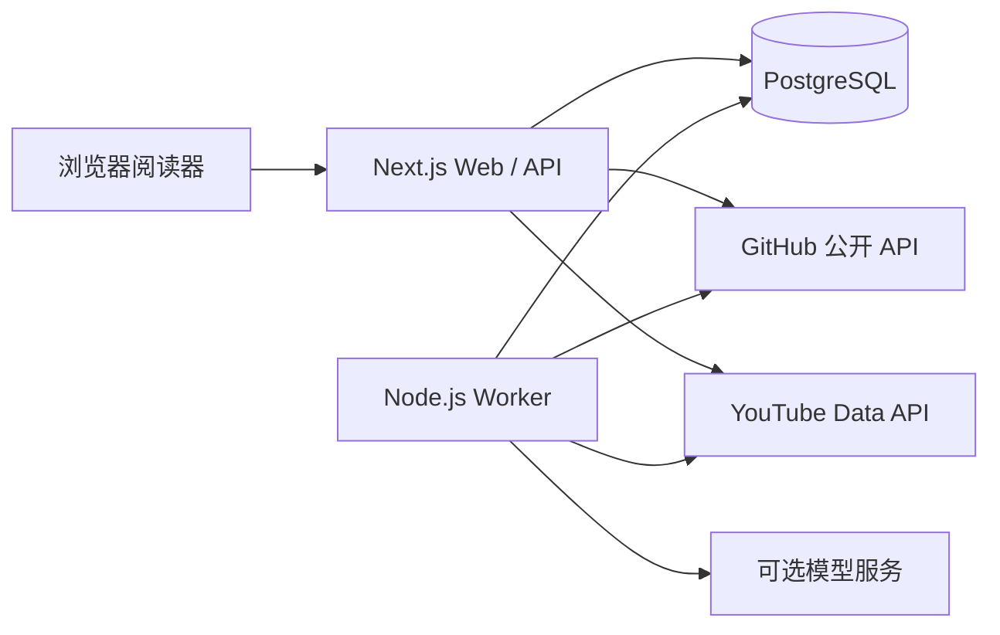

# 技术架构 · 当前实现

更新日期：2026-11-04。

## 运行组成

Web 和 Worker 是两个进程，共享 TypeScript 类型、数据库访问及服务配置。pg-boss 使用同一个 PostgreSQL 的独立 schema，不引入 Redis。Docker Compose 只负责本地 PostgreSQL，已有数据库时可完全不用 Docker。

2026-11-05 聚合优化增量：同一持久队列按精确优先级为 AI、GitHub、YouTube 各保留一个消费者，总并发 3，outbox 每类最多发布 16 个。调度使用一次订阅/检查点 join；YouTube 项目配额冷却持久化并按配置身份隔离，不将账号 401 泛化为全局冷却。

正文内容版本交接通过持久 follow-up 意图和行锁串行，付费任务中断不自动免费重试。摘要/译文按模型、提示词等版本读取；不匹配的真实结果等待手动重新生成，原文、已读和收藏独立可用。详情证据不进入列表载荷。

列表采用每 30 条原生 content-visibility 分组，所有卡片仍在 DOM，分组边界更新保持焦点；不是虚拟列表。Worker 对短期 OAuth、关注预览和配额状态实施有界过期清理，历史内容和费用记录不在清理范围。规则与正式平台验收边界见 [生命周期](22-data-lifecycle-and-recovery.md)，实际证据见 [实施记录](21-aggregation-optimization-progress.md)。

## 技术选择

| 层   | 当前实现                                                  |
| ---- | --------------------------------------------------------- |
| Web  | Next.js 16.3.5 App Router、React 19、TypeScript 5.9.3     |
| UI   | Tailwind 4、语义 CSS、自定义 Button、Radix Dialog、Lucide |
| 内容 | react-markdown + remark-gfm，禁用原始 HTML 执行           |
| 数据 | PostgreSQL 17、Drizzle ORM + pg 事务、版本化 SQL 迁移     |
| 任务 | pg-boss 12.31.0、独立 Node.js 24 Worker、pino             |
| 登录 | Better Auth 1.7.4、GitHub OAuth、稳定用户 ID 允许名单     |
| 采集 | Octokit 22、Zod 校验、可注入 transport                    |
| AI   | 服务端 fetch、兼容 Chat Completions 的结构化 JSON、Zod    |
| 验证 | Vitest 5、真实 PostgreSQL 集成测试、Playwright 1.63       |

版本以 lockfile 为准。初版计划中的 shadcn/ui 未整体引入，实际使用小型自定义组件与 Radix 原语。

## 模块与职责

- `src/shared`：来源、条目、任务、偏好等类型及筛选规则。
- `src/server/db`：数据库连接、事务和带用户约束的持久化。
- `src/server/auth`：配置、会话和访问允许名单，演示仅限本地开发。
- `src/server/connectors/github.ts`：输入验证、公开 API 数据转换，不处理 UI 状态。
- `src/server/platforms`：公共来源/分页/错误/正文补全契约，GitHub 包装适配器与 YouTube Data API 适配器，集中注册工厂与平台检查间隔。
- `src/server/connectors/github-auth.ts` / `github-user.ts`：跨进程续期、加密凭据、401 重试与状态；搜索、采集复用同一账号连接器。
- `src/server/discovery`：Trending 快照、刷新恢复、简介翻译和缓存。
- `src/server/subscriptions`：订阅管理、分页游标、去重、历史边界和同步覆盖。
- `src/server/jobs`：应用任务、事务出站记录、pg-boss 投递和终态恢复。
- `src/server/ai`：摘要/翻译排队、证据校验、缓存、预算和结果存储。
- `src/server/notifications`：站内简报规则与持久化，没有邮件渠道。
- `src/components`：阅读器、详情、订阅和设置；`src/worker`：调度与消费。

## 实际数据模型

MVP 采用按用户保存条目的简化模型，身份与阅读状态为关系字段，内容为带类型的 JSONB。没有实现初稿中的全局来源/全局条目/用户关系多层表结构。

| 表                                      | 内容                                                                     |
| --------------------------------------- | ------------------------------------------------------------------------ |
| app_users                               | 业务用户，演示用户为 demo                                                |
| subscriptions                           | 用户、平台、来源种类与外部 ID 唯一，JSONB 保存状态和适配器元数据          |
| platform_connections                    | 用户与平台唯一的加密账号凭据、连接版本、续期与失效状态                    |
| items                                   | 用户与事件外部 ID 唯一，JSONB 保存原文/摘要/译文，已读/收藏/屏蔽独立字段 |
| preferences                             | 时区、紧凑列表                                                           |
| jobs                                    | 任务状态和待投递记录，与业务写入同一事务                                 |
| star_sync / star_sync_exclusions        | 每用户自动 Star 检查开关、分页检查点、重试期限与应用内取消订阅的排除记录 |
| ai_usage / ai_cache                     | 预算预留、实际用量或不确定费用、按内容与模型缓存                         |
| notifications                           | 站内 Markdown 简报                                                       |
| system_state                            | 扫描游标、调度时间、Trending 快照、授权错误指纹和 Worker 心跳                           |
| app_migrations                          | 已执行的 SQL 文件                                                        |
| user / session / account / verification | Better Auth 会话与 OAuth 数据                                            |

早期迁移中的 notification_items 表目前未使用，不代表邮件功能。迁移文件为数据库结构的完整依据；Drizzle schema 仅覆盖业务查询使用的表，不要将 `db:generate` 输出未经检查直接应用，以免误删手工管理的 Auth/队列表。

## 任务可靠性

1. 新订阅和同步任务在同一事务保存，避免订阅成功但任务丢失。
2. Worker 使用 `FOR UPDATE SKIP LOCKED` 领取未投递记录，pg-boss 使用应用任务 UUID；入队与投递标记同事务提交。
3. 活动任务按用户、类型、目标去重，普通同步错误允许有限重试。
4. 每页条目与检查点同事务保存；用户内事件按平台、类型和外部 ID 去重，GitHub 历史外部键保持不变。合并 sourceIds，重复采集不重置阅读状态；正文 hash 变化清除过期生成结果，版本更新时间阻止旧响应回写。
5. Worker 对同步设置 240 秒取消期限，小于队列 300 秒期限。取消信号传递到 HTTP 与保存检查。
6. 定期核对 pg-boss 终态；崩溃、超时或缺失任务不永久显示运行中，网页可重新同步。
7. GitHub 限流等待期限持久化，自动和手动入口都遵守。

项目 Release 同步按用户、订阅和页码保存 ETag 及分页元数据，后续发送 `If-None-Match`；304 不改写该页条目，仍继续检查已知后页，完整末页还允许探查新增下一页。每轮最多 5 页，页码、历史额度与进度在同一事务中持久化；双流优先显示仍待续传的进度。作者仓库列表不使用条件请求短路，仍读取 README 检查正文修改；公开事件流保留独立检查点。

信息流 API 使用 `(published_at,id)` 复合 keyset 游标及 `items_visible_feed_idx`，每次最多 30 行。列表只传 `FeedPreview`，不包含正文、译文、翻译块或摘要证据；bootstrap 不重复序列化列表。全文由用户隔离的单条详情 API 按需获取。迁移 0004 增加元数据生成搜索列与 pg_trgm 索引，搜索标题、项目、描述和标签；不搜索全文。

浏览器保留最多 8 组筛选分页缓存及有限条目预览，选中/在途条目受淘汰保护；批量已读按整个当前筛选更新数据库。请求代次与 mutation 版本保护避免旧页、旧计数、旧详情覆盖新状态。轮询只取 metadata 与状态/headId，活跃 1.5 秒、空闲 30 秒，失败退避至 120 秒，隐藏/离线暂停并取消；收到新更新先提示、用户确认后重载列表。

`/api/health/live` 表示 Web 存活；`/api/health/ready` 检查数据库、迁移和 Worker，只有 Worker 离线时允许降级阅读。Demo 启动器等待本次新 Worker 心跳，启动失败清理自身子进程，ready 后 Worker 单独退出保留 Web。列表/详情失败保留已有内容，可局部重试。

## AI 与访问边界

模型端点由服务端环境变量控制，前端不可指定任意目标。使用 `/chat/completions`、`response_format: json_schema` 与 `max_completion_tokens`；供应商必须支持这些字段。原文作为不可信内容传入，没有工具调用或发消息权限。

缓存包含内容 hash、仓库、事件类型、任务种类、语言、提示版本、模型与服务地址。生成完成前再次匹配原文 hash，避免旧结果覆盖新正文。预算使用数据库锁预留；请求超时保留保守费用，不能当作退款。

业务查询包含 user_id；写请求验证 Origin。OAuth token 在 Better Auth 内加密，登录密钥不交给浏览器。演示模式在生产环境或公网 APP_URL 下拒绝运行。

## 平台扩展

平台无关的 `PlatformAdapter` 负责来源解析、流定义、opaque cursor、条件请求和正文补全；公共同步编排负责事务、用户隔离、去重、历史额度、阅读状态与任务。适配器返回 `sourceName`，仅在兼容旧存储时映射到 `repo`。迁移 0005 回填 GitHub 平台并扩展订阅唯一键，不改变历史条目 ID、阅读状态或摘要。

GitHub 已通过适配层工作，保留双流与 ETag 语义。YouTube 的鉴权由服务端 transport 隔离：个人连接使用加密 OAuth 凭据及自动续期，旧 API Key 仅保留手动来源兼容。迁移 0006 新增按用户 + 平台唯一的 `platform_connections`；连接/撤销/续期串行，generation 隔离旧回调与关注导入。我的关注只读 `subscriptions.list(mine=true)`，分页预览绑定用户、连接版本和有效期，成功后页可缓存重放；最多 50 个频道一次批量解析，再复用订阅事务和 outbox。

频道更新通过 uploads 分页与最多 50 个视频批量元数据请求读取；默认 180 分钟、每轮前 5 页/250 项窗口，旧页提前结束，下一轮回首页。opaque cursor 持久化并在失效时只清理对应来源检查点。简介纯文本、封面懒加载、原站观看；API 和 Worker 都阻止视频全文 AI。

用户已确认 G4 暂缓期间推进 YouTube Demo；真实 OAuth/网络验证、长期使用与公开部署分开验收。Bilibili、X、RSS 尚未实现，后续平台在契约与注册表扩展，不能把平台分页/鉴权规则复制到公共事务。细节见 [适配层与 YouTube](18-platform-adapters.md) 和 [账号与关注](19-youtube-account-following.md)；历史 X/RSS 预研见 [跨平台扩展预研](14-platform-expansion.md)。
